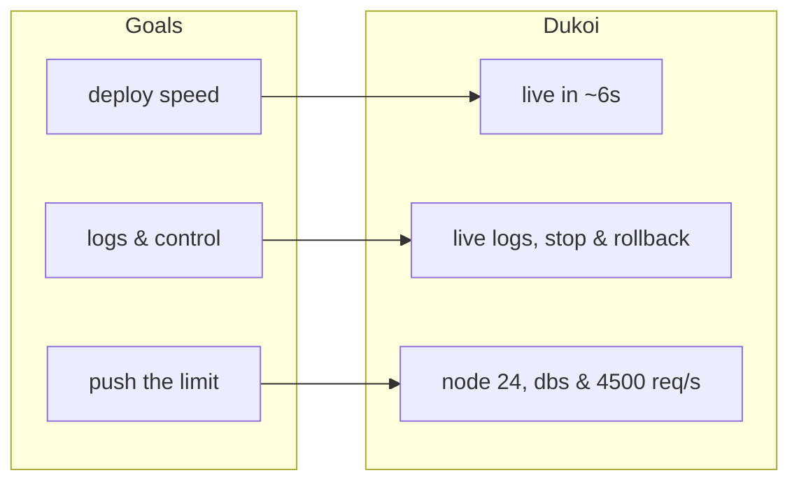
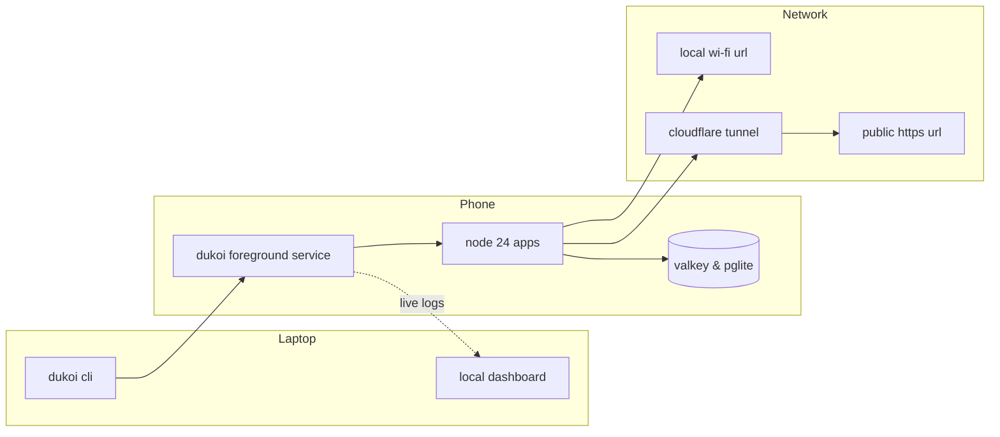
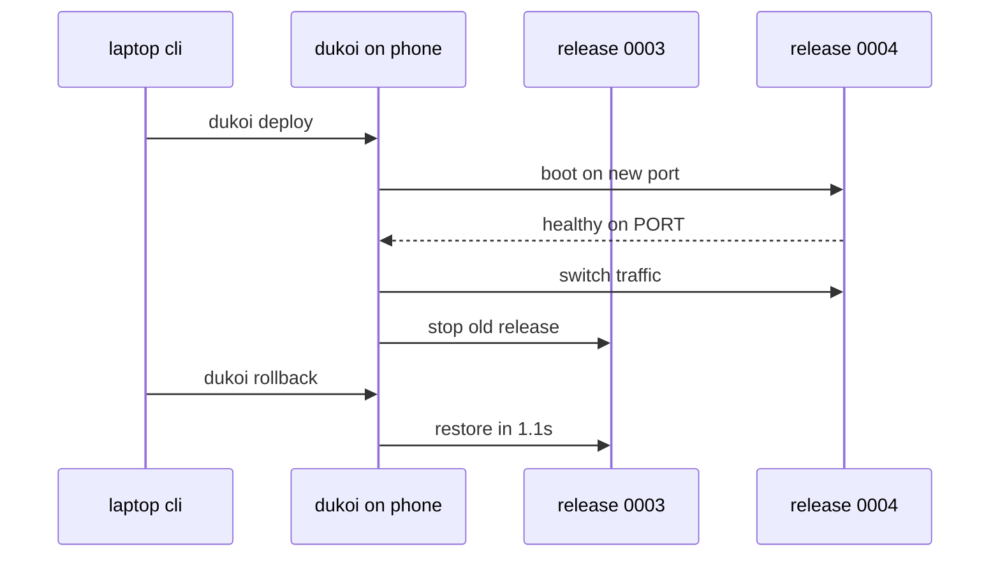
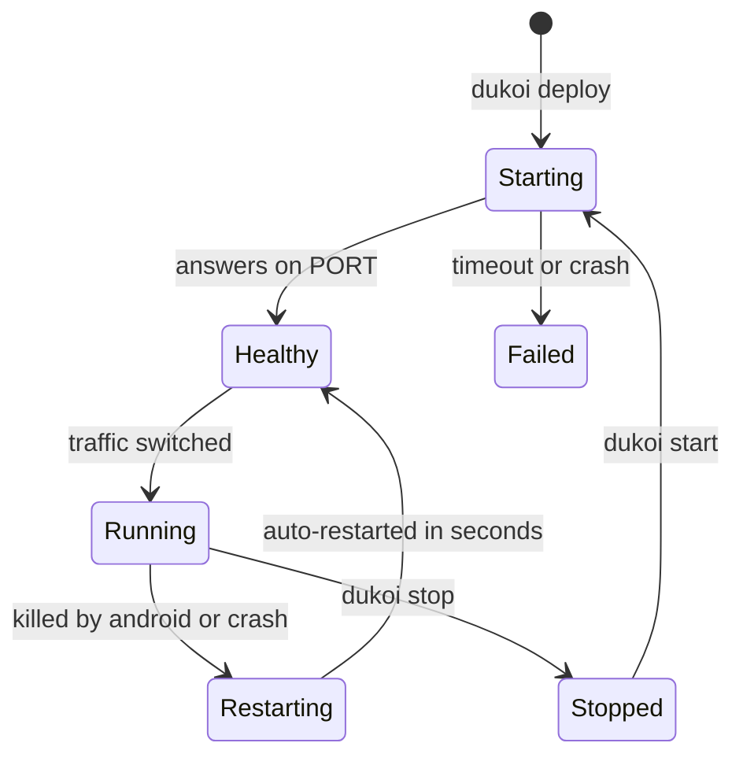
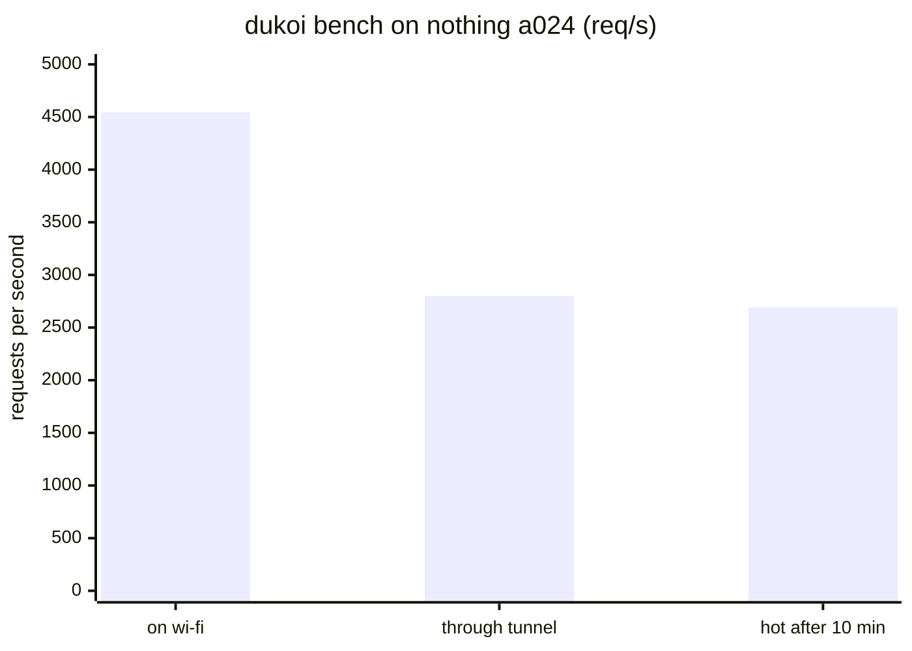
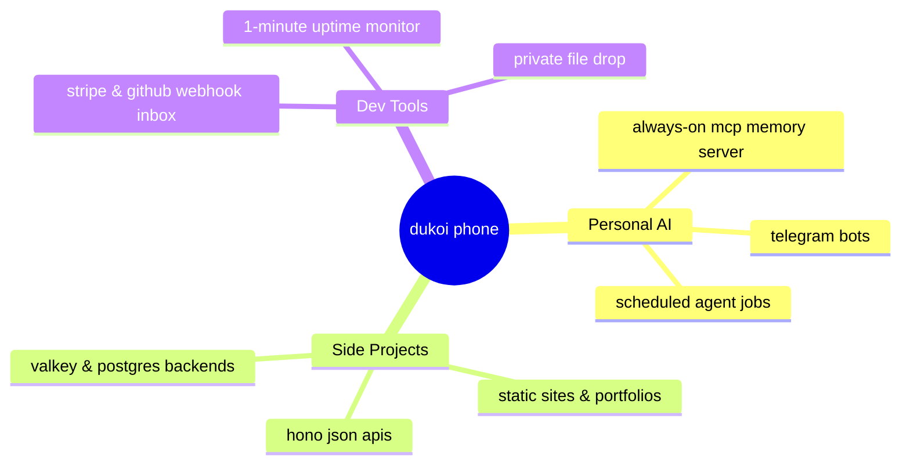

import { Highlight, Sidenote } from "@components/interactive";
import { EndCTA } from "@components/cta";

a few months ago [droidclaw](https://droidclaw.ai) went viral. right after that i joined [agi inc.](https://theagi.company) as a founding ai engineer to build a mobile personal agent.

my weekdays became all about phones. how agents live on them, what they can see, what they can do. somewhere in the middle of that a weekend idea popped into my head. i kept looking at a spare android phone on my desk and thinking i should turn this thing into a server.

not a hacky termux setup where you fight ssh for an hour and pray android doesn't kill your process when the screen turns off. i wanted a real server that felt fast and clean.

my goals were super simple. how fast can i deploy something. how easy is it to see logs, stop, and restart whenever i want. and how far can i actually push this whole android server idea.



as usual i went deep into tons of docs and resources. android foreground services, battery optimization, how android 12 and newer kills child processes for using too much cpu, how every phone maker adds its own hidden app killer on top, and how to run node 24 cleanly with no root and no termux.

that weekend rabbit hole turned into [dukoi](https://dukoi.com).

## how the whole thing fits together

the goal was going from a phone in a drawer to a live url in about two minutes.

you install the [dukoi apk](https://dukoi.com/download/dukoi.apk) on a spare android phone. the app walks you through four checks that stop android from killing your server. each one only turns green once android actually confirms it.

then you install the cli on your laptop and pair over the same wi-fi.

```sh
curl -fsSL https://dukoi.com/install | sh
dukoi pair
```

your computer finds the phone, shows a six-digit code, you tap **approve**, and they swap keys. no passwords. all control stays on your local wi-fi and never goes through a tunnel.

after that you walk into any node or static site folder and run `dukoi deploy`.



one small decision made deploys feel instant. **the phone never runs `npm`.** your computer builds typescript, installs production dependencies, packs the folder, and ships the bundle over wi-fi. a small hono api goes live in about six seconds.

## zero-downtime releases and one-second rollbacks

every deploy creates a numbered release. the phone keeps the last five.

when you ship a new version, dukoi boots it next to the old one and waits up to ten seconds for it to answer on `PORT`. traffic only switches once the new release is healthy, and then the old one stops. if the new build crashes, the old one keeps serving like nothing happened.



if you push a bug, `dukoi rollback` puts you back on the previous release in about a second. your `DATA_DIR` lives outside the release folders, so rolling back code never wipes your data.

## keeping apps alive on android

android loves killing background apps to save battery. that's the main reason most phone server experiments die overnight.

dukoi runs as a foreground service, tracks every child process, and restarts anything that dies within seconds. if android stops an app, dukoi brings it right back and writes a clear line in your logs explaining why it restarted. if the phone reboots, everything that was running comes back up on its own.



logs stream live in three places. your terminal with `dukoi logs`, the phone screen itself, and a local web dashboard that runs on your computer with restart and rollback buttons a click away.

a phone plugged in all day also wears out its battery and can swell, so dukoi watches it and helps you cap charging at 80%.

## how far you can push an old phone

once you look at the hardware inside a spare phone, paying five dollars a month for a tiny vps starts feeling silly. a \$5 server gives you 1 vcpu, 1 gb of ram, and 25 gb of disk. a flagship from 2019 in your drawer has 8 cores, 6 gb of ram, 128 gb of storage, pulls 2 to 5 watts, and has a built-in battery for power cuts.

i built `dukoi bench` to see what a real phone actually does under load. on a nothing a024 running android 16 with 12 gb of ram, it served **4,544 req/s** on wi-fi at a 13 ms p99. even after ten minutes of load at 39 °c, it held **2,690 req/s** through a public tunnel<Sidenote id="1">run `dukoi bench --share` on your own phone to compare models on [dukoi.com/bench](https://dukoi.com/bench).</Sidenote>.



and it doesn't stop at tiny scripts. you can run real databases right next to your apps. `dukoi db create redis` starts valkey 9.1 using about 10 mb of ram. `dukoi db create postgres` starts pglite, which is real postgres 18 running on the phone's node. dukoi wires `REDIS_URL` or `DATABASE_URL` into your app and restarts it automatically.

need a public url behind cgnat with no router config. `dukoi expose` gives you a public https link in seconds, or you can point your own domain through cloudflare.

it's also built for coding agents from day one. installing the cli automatically teaches claude code, codex, and cursor how to use dukoi, every command supports `--json`, and `dukoi mcp` lets any mcp client talk to your phone directly. you can literally ask your agent to build a telegram bot that sends you the weather every morning and deploy it to your phone.

## what all the possibilities look like

when hosting is free and deploys take six seconds, you start building smaller and more personal software again. stuff you'd never bother spinning up a cloud server for.



an mcp server that gives your ai assistant memory all day on your own hardware. a private file drop where files stay on your phone instead of someone else's cloud. a webhook inbox for testing stripe or github without paying for a tool. a cron runner. an uptime monitor that pings you when a site goes down.

<Highlight color="yellow">the coolest part isn't just saving five bucks a month. it's having a tiny, always-on personal cloud sitting right on your desk.</Highlight>

it started as a weekend experiment to see how fast i could deploy to an android phone and read its logs. now it's free, open source at [thisuxhq/dukoi](https://github.com/thisuxhq/dukoi), and live at [dukoi.com](https://dukoi.com). grab an old phone out of your drawer and see what you can run on it.

<EndCTA
	title="got an old android phone in a drawer? try dukoi and tell me what you ship on it."
	cta_label="check out dukoi.com"
	bg_colour="orange"
	link="https://dukoi.com"
/>
