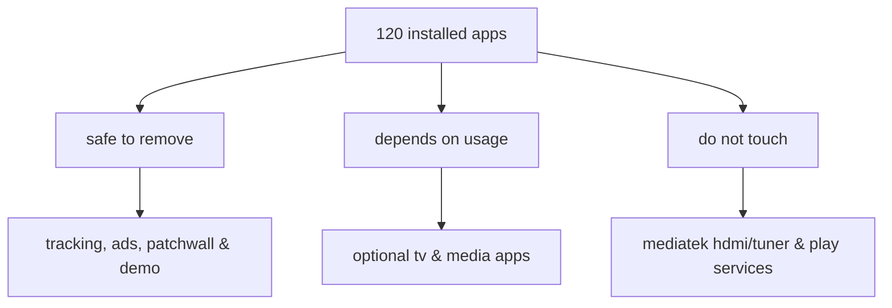
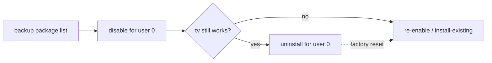
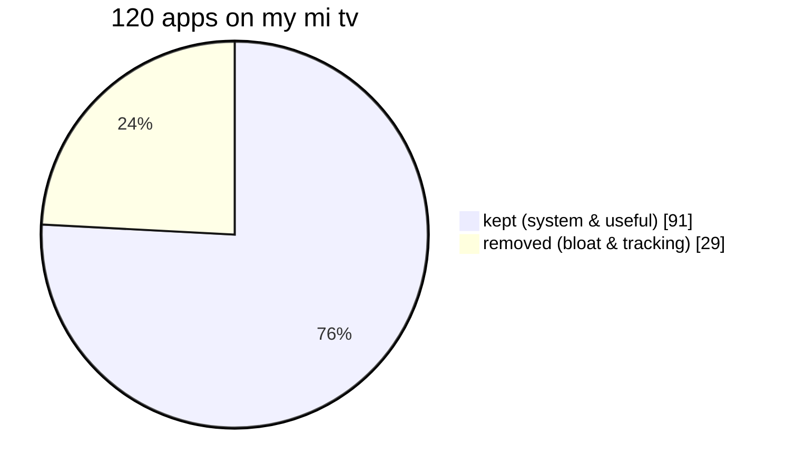

import { Highlight, Sidenote } from "@components/interactive";
import { EndCTA } from "@components/cta";

i saw this post from ryan doyle and wanted the same thing for my tv.

<blockquote class="twitter-tweet"><p lang="en" dir="ltr">Hacked my TV with Claude Code today<br /><br />No more ads, bloatware, spyware or laggy UI<br /><br />I also got a beautiful screensaver with my revenue, calendar, weather, and notifications for new Stripe payments<br /><br />It was super easy! I sent it the listing for my tv, asked &quot;can you hack this?&quot; And it talked me through how</p>Ryan Doyle (@doooyle) <a href="https://x.com/doooyle/status/2111196679680540724?ref_src=twsrc%5Etfw">October 16, 2026</a></blockquote> <script async src="https://platform.x.com/widgets.js" charset="utf-8"></script>

my mi tv was slow. the home screen was packed with sponsored rows, xiaomi was quietly sending usage data back home, and half the apps on it were things i had never opened once. so i sat down with claude code and cleaned the whole thing up.

## no root, just adb

android tvs have a hidden developer menu. open settings, go to device preferences, then about, and click build seven times. once developer options show up, turn on usb debugging. on mi tvs that also lets you connect straight over wifi.

```bash
adb connect 192.168.0.111
```

the tv pops up a prompt asking if it should trust your computer. hit yes and you're in.

## back up the list first

before deleting anything i dumped every installed package to a text file.

```bash
adb shell pm list packages > packages-backup.txt
```

120 apps total. most of them keep the tv alive. a bunch of them really don't.

## sort them into three piles

i split all 120 apps into three buckets. safe to remove, depends on what i use, and do not touch. the do not touch pile is big. the mediatek packages run the hdmi ports, the tuner, and the picture. google play services runs most of the rest.



the safe pile had the usual suspects

- `com.miui.tv.analytics` and `com.xiaomi.statistic`, xiaomi's tracking
- `fusion.android.tv.demo`, the store demo mode
- `com.mitv.tvhome.michannel`, the sponsored content row
- `com.mitv.tvhome.atv`, patchwall, the laggy xiaomi home screen
- `com.xiaomi.mitv.updateservice`, the thing pushing xiaomi updates

## disable first, then uninstall

i didn't nuke anything straight away. i disabled each package first so i could undo a mistake in one line.

```bash
adb shell pm disable-user --user 0 com.miui.tv.analytics
```

once i tested the tv and everything still worked fine, i uninstalled them for my user.

```bash
adb shell pm uninstall --user 0 com.miui.tv.analytics
```

<Highlight color="yellow">this never wipes the app from the system partition.</Highlight> it only removes it for user 0, so a factory reset brings everything back<Sidenote id="1">to bring one app back without a reset, run `adb shell cmd package install-existing` with the package name.</Sidenote>. that makes the whole thing way less scary to try.



## 29 apps gone

i rebooted the tv to make sure nothing quietly reinstalled itself. nothing did. it dropped from 120 apps down to 91 and immediately felt snappier. no sponsored rows, no xiaomi tracking, no patchwall.



after that i used the clean slate to build my own screensaver. that's a post for another day.

<EndCTA
	title="i write about building with agents. follow along if you want the next one."
	cta_label="follow on x"
	bg_colour="orange"
	link="https://x.com/spikeysanju"
/>
